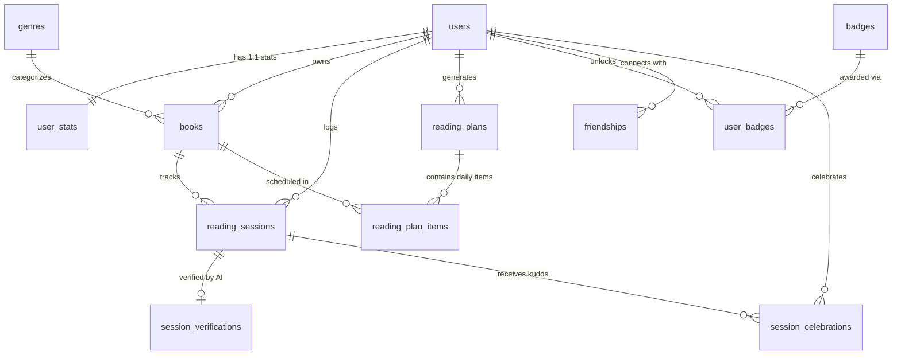

# 📚 kutubuku

> **Duolingo & Strava for Reading Books** — A gamified reading journal and AI-powered reading planner designed to cure *tsundoku* (buying books that end up collecting dust) and build daily reading habits.

**Status:** Active Development (Phase 1 MVP UI & Phase 2 PostgreSQL Schema Ready)  
**Course:** Database Technology (`COMP6852004`) — Class **BH20**, Computer Science — **BINUS University**

---

## 🎯 Problem Statement, Urgency & Target Audience

### 1. The Core Problem
Many book buyers suffer from ***tsundoku***—acquiring multiple physical or digital books with good intentions, only to leave them unfinished collecting dust on the shelf because of:
1. **Overwhelm & Lack of Pacing:** Having 3–5 unread books without a clear daily schedule (*jadwal baca*) of what and how much to read each day.
2. **Lack of Immediate Feedback:** Unlike games or fitness apps (Strava, Duolingo), reading a physical book offers no immediate streak, XP, or social celebration.
3. **Fake Accountability:** Existing trackers allow users to click "read" without proving comprehension, making streaks meaningless.

### 2. Why This Is Urgent (Backed by Data)
Indonesia faces a well-documented literacy and reading habit challenge (**"Indonesia Darurat Membaca"**):
- **UNESCO Reading Interest Index:** Indonesia's reading interest index is frequently cited at **0.001** (meaning roughly only 1 in 1,000 people has an active, consistent daily reading habit).
- **PISA 2022 Reading Literacy Score:** Indonesia scored **359** in Reading (OECD average: **476**), ranking among the bottom tier globally and marking a decline from previous cycles.
- **Perpusnas RI (Tingkat Kegemaran Membaca / TGM):** While book access is rising in urban areas, **reading duration and book completion rates** remain low—most book buyers purchase books at fairs (e.g., Big Bad Wolf, Gramedia) but complete fewer than 2–3 books per year.

### 3. Target Audience
- **Book Hoarders & Casual Readers:** People who own multiple unfinished physical/digital books and need a realistic weekly reading schedule.
- **Habit Builders & Self-Improvers:** Readers motivated by streaks, XP levels, achievement badges, and friendly social accountability ("Bros" feed & celebrations).

---

## ✨ Key Features & Solutions

1. **Personal Book Inventory & Progress Tracking:** Input owned books (`want_to_read`, `reading`, `completed`), total pages, genres, and track completion percentage.
2. **AI-Powered Weekly Reading Planner (*Jadwal Baca*):** Spreads reading load across owned books for the week based on the user's average reading speed and daily target pages.
3. **Anti-Cheat AI Reading Verification (BYOK Gemini API):**
   - To solve **fake streak farming**, users can input their own free **Google Gemini API Key** (Bring Your Own Key / BYOK).
   - When logging a session, the AI asks a brief comprehension/reflection question about the pages or chapter just read and awards verified bonus XP.
4. **Gamification & Social Accountability ("Bros"):**
   - Daily streaks, 7-day habit strips, XP levels, unlockable badges, and a social feed where friends can **Celebrate 🎉** each other's reading milestones.

---

## 🗄️ Database Architecture (12 Normalized Tables)

Designed in **3rd Normal Form (3NF)** for **PostgreSQL** (compatible with **pgAdmin 4** locally and **Supabase** in production).

- 📄 **DDL Schema (`CREATE TABLE`):** [`db/schema.sql`](db/schema.sql)
- 🌱 **DML Seed Data (`INSERT INTO`):** [`db/seed.sql`](db/seed.sql)

### Entity-Relationship Overview



### Explanation of the 12 Tables

| # | Table Name | Role & Justification |
| :- | :--- | :--- |
| **1** | `users` | Stores user accounts, profile display info, daily reading goals (`daily_target_pages`), and BYOK Gemini status. |
| **2** | `user_stats` | **1:1 with `users`**. Tracks real-time gamification state (`streak_days`, `longest_streak`, `total_xp`, `current_level`, `today_pages_read`). |
| **3** | `genres` | **3NF Lookup Table**. Normalizes book genres (`Self-Improvement`, `Productivity`, `Fiction`) to prevent string duplication across books. |
| **4** | `books` | User's owned book collection (`title`, `author`, `isbn`, `total_pages`, `current_page`, `status`). |
| **5** | `reading_sessions` | Core transactional log whenever a user reads (`pages_read`, `start_page`, `end_page`, `minutes_read`, `notes`, `xp_earned`, `is_verified`). |
| **6** | `session_verifications` | **AI Anti-Cheat Table**. Stores the Gemini-generated comprehension prompt, user's answer, AI feedback, and `verification_status` (`pending`, `verified`, `flagged`). |
| **7** | `reading_plans` | **Schedule Header**. Stores weekly reading plans (`week_start_date`, `target_pages_per_day`, `projected_weekly_pages`, `ai_rationale`). |
| **8** | `reading_plan_items` | **Schedule Detail**. Breaks a weekly plan into day-by-day book assignments (`scheduled_date`, `book_id`, `target_pages`, `is_completed`). |
| **9** | `badges` | **Master Catalog**. Defines unlockable achievements (`3-Day Streak`, `100 Pages Read`, `First Book Finished`, etc.) and their XP rewards. |
| **10** | `user_badges` | **M:N Junction Table**. Records which user unlocked which badge and the exact `unlocked_at` timestamp. |
| **11** | `friendships` | **Social Graph**. Tracks friend connections ("Bros") between users (`requester_id`, `addressee_id`, `status`). |
| **12** | `session_celebrations` | **Social Interactions**. Records "Celebrate 🎉" reactions from friends on a user's reading session. |

---

## 🛠️ Tech Stack

- **Frontend & Fullstack Framework:** SvelteKit (Svelte 5 Runes) + TypeScript
- **Styling:** Tailwind CSS v4 (Mobile-first, Duolingo-inspired tactile UI)
- **Database:** PostgreSQL (Local testing in **pgAdmin 4**, Cloud hosted on **Supabase**)
- **Deployment:** **Vercel**
- **AI Integration (Planned):** Google Gemini API (Bring Your Own Key / BYOK for zero-cost student hosting)

---

## 🚀 Getting Started

### 1. Local Web App Setup
```bash
# Install dependencies
npm install

# Start development server at http://localhost:5173
npm run dev

# Run TypeScript & Svelte checks
npm run check
```

### 2. Setting Up PostgreSQL (pgAdmin 4 or Supabase)
1. Open **pgAdmin 4** (Query Tool) or **Supabase Dashboard** (SQL Editor).
2. Execute [`db/schema.sql`](db/schema.sql) to create all 12 tables, constraints, and indexes.
3. Execute [`db/seed.sql`](db/seed.sql) to populate sample users, books, sessions, AI verifications, and weekly plans.

---

## 📂 Project Structure

```text
kutubuku/
├── db/
│   ├── schema.sql                # 12-table PostgreSQL DDL schema
│   └── seed.sql                  # Sample DML seed data for testing & demo
├── src/
│   ├── lib/
│   │   ├── components/           # Reusable Svelte 5 UI components
│   │   ├── data/
│   │   │   └── mock.ts           # In-memory store (being migrated to Supabase PG)
│   │   └── types.ts              # TypeScript interfaces matching PostgreSQL entities
│   └── routes/
│       ├── +layout.svelte        # Responsive shell with BottomNav & SidePanel
│       ├── +page.svelte          # Dashboard (Streak, Daily Goal, Active Book)
│       ├── books/[id]/           # Book detail & reading session logger
│       ├── planner/              # Weekly reading schedule & reading queue
│       ├── bros/                 # Social friend updates & Celebrate interactions
│       └── profile/              # User level, XP progress, badges & history
├── AGENTS.md                     # Context & architectural rules for AI coding agents
└── README.md                     # Project overview & documentation
```

---

## 👥 Team — Class BH20 (BINUS University)

| Name | Student ID | Role | GitHub |
| :--- | :--- | :--- | :--- |
| **Stella Olivia Setiadi** | 2902652922 | Frontend / UI Engineer | [@stellaollie](https://github.com/stellaollie) |
| **Putra Abyasa Wedha** | 2902583635 | Fullstack / Database Engineer | [@Abysswdh](https://github.com/Abysswdh) |
| **Ricky Satria Ardana** | 2902567631 | Backend / AI Integration | [@RickySAT](https://github.com/RickySAT) |
