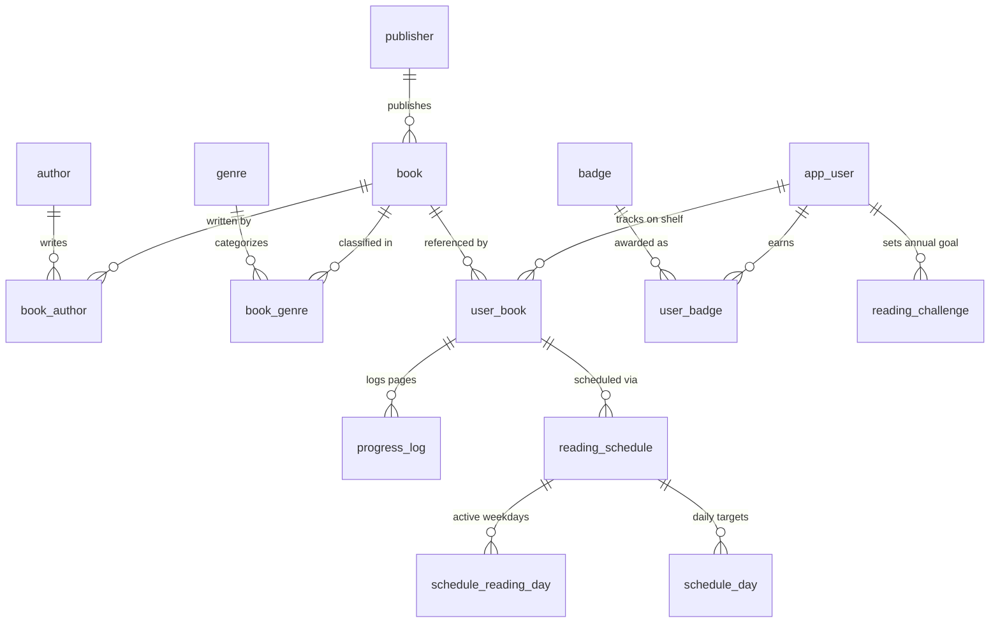

# 📚 kutubuku

> **Duolingo & Strava for Reading Books** — A gamified reading journal and smart reading planner designed to cure *tsundoku* (buying books that end up collecting dust) and build daily reading habits.

**Status:** Active Development (Mock UI Ready + 15-Table Supabase PostgreSQL Schema Ready)  
**Course:** Database Technology (`COMP6852004`) — Class **BH20**, Computer Science — **BINUS University**

---

## 🎯 Problem Statement, Urgency & Target Audience

### 1. The Core Problem
Many book buyers suffer from ***tsundoku***—acquiring multiple physical or digital books with good intentions, only to leave them unfinished collecting dust on the shelf because of:
1. **Concurrent Book Overwhelm:** Starting too many books at once without a limit (`maxConcurrentBooks`), leading to dropped books (`dropReason`: `'too_many_books'`, `'overwhelmed'`).
2. **Lack of Pacing (*Jadwal Baca*):** Not knowing how many pages per day are needed to finish a book by a target date.
3. **Lack of Immediate Feedback:** Unlike games or fitness apps (Strava, Duolingo), reading a physical book offers no immediate streak, badge, or visual habit loop.

### 2. Why This Is Urgent (Backed by Data)
Indonesia faces a well-documented literacy and reading habit challenge (**"Indonesia Darurat Membaca"**):
- **UNESCO Reading Interest Index:** Indonesia's reading interest index is cited at **0.001** (roughly only 1 in 1,000 people maintains an active daily reading habit).
- **PISA 2022 Reading Literacy Score:** Indonesia scored **359** in Reading (OECD average: **476**), ranking in the bottom tier globally.
- **Perpusnas RI (Tingkat Kegemaran Membaca / TGM):** While book purchases at book fairs remain popular, actual **book completion rates and daily reading duration** remain critically low.

### 3. Target Audience
- **Book Hoarders & Casual Readers:** People who own multiple unfinished physical/digital books and need a structured reading schedule.
- **Habit Builders & Self-Improvers:** Readers motivated by streaks, milestones, annual reading challenges, and daily habit strips.

---

## 🗄️ Database Architecture (15 Normalized Tables on Supabase)

Designed in **3rd Normal Form (3NF)** for **Supabase (PostgreSQL)** using BINUS Lab-style `CHAR(10)` regex-validated keys (`^BK\d{8}$`, `^US\d{8}$`, etc.).

- 📄 **DDL Schema (`CREATE TABLE`):** [`db/schema.sql`](db/schema.sql) (adopted from [`KutuBukuu(6).sql`](KutuBukuu(6).sql))
- 🌱 **DML Seed Data (`INSERT INTO`):** [`db/seed.sql`](db/seed.sql)

### Entity-Relationship Overview



### Explanation of the 15 Tables

| # | Table Name | ID Format | Role & Justification |
| :- | :--- | :--- | :--- |
| **1** | `publisher` | `PU\d{8}` | **3NF Lookup**. Stores book publisher names (`publisherName`). |
| **2** | `author` | `AU\d{8}` | **3NF Entity**. Stores author details (`authorName`, `biography`, `birthDate`, `nationality`). |
| **3** | `genre` | `GN\d{8}` | **3NF Lookup**. Unique book genres (`Self-Improvement`, `Productivity`, `Fiction`). |
| **4** | `book` | `BK\d{8}` | **Master Book Catalog**. Global book metadata (`title`, `isbn13`, `publishDate`, `pageCount`, `publisherID`). |
| **5** | `book_author` | Composite PK | **M:N Junction Table**. Connects `book` and `author` (supports multi-author books). |
| **6** | `book_genre` | Composite PK | **M:N Junction Table**. Connects `book` and `genre` (supports multi-genre books). |
| **7** | `app_user` | `US\d{8}` | **Core User Entity**. Account profile, `maxConcurrentBooks` limit, `currentStreak`, and `longestStreak`. |
| **8** | `user_book` | `UB\d{8}` | **Personal Shelf**. Tracks a user's copy of a book (`status`: `planned`, `reading`, `paused`, `finished`, `dropped`, plus `dropReason`). |
| **9** | `progress_log` | `PL\d{8}` | **Reading Sessions**. Logs `startPage`, `pagesRead`, `currentPage`, `minutesRead`, and `note` with `CHECK (currentPage = startPage + pagesRead)`. |
| **10** | `reading_schedule` | `RS\d{8}` | **Schedule Header**. Target dates and pace (`pagesPerDayTarget`, `estimatedPagesPerDay`, `predictedFinishDate`) for an active `user_book`. |
| **11** | `schedule_reading_day` | Composite PK | **Weekly Habit Days**. Stores which days of the week (`1`–`7`) the user commits to reading. |
| **12** | `schedule_day` | `SD\d{8}` | **Daily Schedule Detail**. Concrete calendar dates (`scheduledDate`, `targetPages`, and status `pending`, `completed`, `missed`). |
| **13** | `badge` | `BD\d{8}` | **Achievement Catalog**. Defines milestones (`streak_days`, `books_finished`, `pages_read`) and threshold values. |
| **14** | `user_badge` | Composite PK | **M:N Junction Table**. Records which user unlocked which badge and when (`awardedAt`). |
| **15** | `reading_challenge` | `RC\d{8}` | **Annual Goal**. Stores a user's yearly reading target (`challengeYear`, `targetBooks`, `targetPages`). |

---

## 🛠️ Tech Stack & Cloud Hosting

- **Framework:** SvelteKit (Svelte 5 Runes) + TypeScript
- **Styling:** Tailwind CSS v4 (Duolingo-inspired tactile UI)
- **Cloud Database:** **Supabase** (Hosted PostgreSQL — tables created via Supabase SQL Editor or Table Editor)
- **Web Hosting:** **Vercel**
- **AI Integration (Planned):** Google Gemini API (Bring Your Own Key / BYOK)

---

## 🚀 Getting Started

### 1. Run the App Locally (Currently on Mock Data)
```bash
npm install
npm run dev
```
Open `http://localhost:5173`.

### 2. Initialize Your Supabase Cloud Database
Even though we host on **Supabase** (instead of Railway), Supabase is powered by PostgreSQL under the hood. Instead of manually clicking "Create Table" 15 times in the Supabase GUI:
1. Create a free project at [supabase.com](https://supabase.com).
2. In your Supabase sidebar, click **SQL Editor** → **New Query**.
3. Copy-paste [`db/schema.sql`](db/schema.sql) and click **Run** (this creates all 15 tables and constraints in 1 second in your hosted Supabase database!).
4. Copy-paste [`db/seed.sql`](db/seed.sql) and click **Run** to populate your Supabase tables with initial data.

---

## 👥 Team — Class BH20 (BINUS University)

| Name | Student ID | Role | GitHub |
| :--- | :--- | :--- | :--- |
| **Stella Olivia Setiadi** | 2902652922 | Frontend / UI Engineer | [@stellaollie](https://github.com/stellaollie) |
| **Putra Abyasa Wedha** | 2902583635 | Fullstack / Database Engineer | [@Abysswdh](https://github.com/Abysswdh) |
| **Ricky Satria Ardana** | 2902567631 | Backend / AI Integration | [@RickySAT](https://github.com/RickySAT) |
